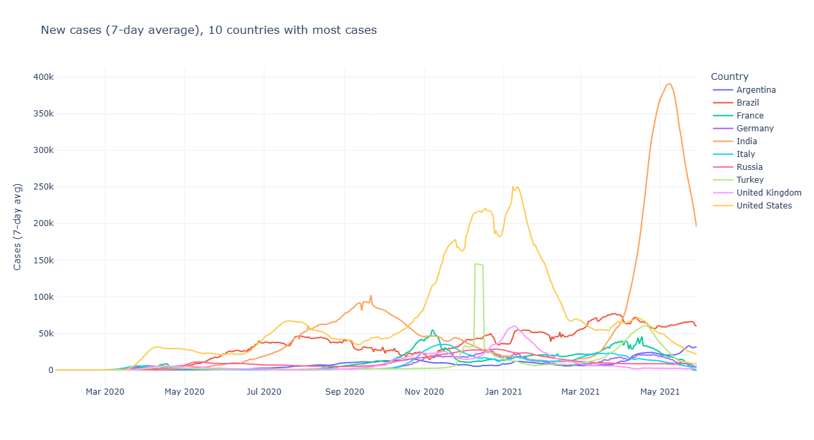
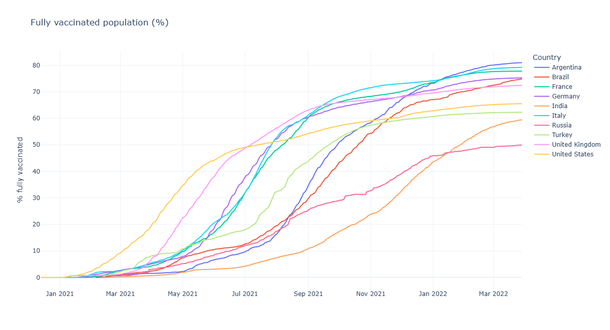
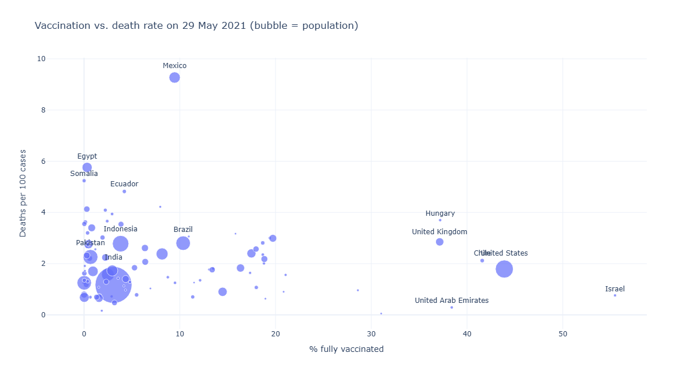

# Public Health Data Tracker

Interactive visualisation of cases, recoveries and vaccination trends across countries over time (Jan 2020 - Mar 2022).

**Tech:** Python, Pandas, Plotly, Power BI

## Project structure

```
Public Health Data Tracker/
├── data/
│   ├── raw/              Kaggle CSVs (download them, see Data below)
│   └── processed/        covid_clean.csv + cleaning_log.txt
├── src/
│   ├── 02_clean_data.py     clean + merge + metrics
│   └── 03_make_charts.py    Plotly charts
├── charts/               7 interactive HTML charts (open in a browser)
│   └── images/           PNG screenshots of each chart
├── powerbi/              POWERBI_GUIDE.md
├── requirements.txt
└── README.md
```

## How to run

1. Download the two CSV files listed under **Data** and put them in `data/raw/`.
2. Run:

```bash
pip install -r requirements.txt
python src/02_clean_data.py
python src/03_make_charts.py
```
Then open any file in `charts/`.

## Data
The raw files are not stored in this repo. Download them from Kaggle into `data/raw/`:

| File | Source | Content |
|---|---|---|
| `covid_19_data.csv` | [Novel Corona Virus 2019 Dataset](https://www.kaggle.com/datasets/sudalairajkumar/novel-corona-virus-2019-dataset) (SRK, based on Johns Hopkins data) | cases, deaths, recoveries, 22 Jan 2020 - 29 May 2021 |
| `country_vaccinations.csv` | [COVID-19 World Vaccination Progress](https://www.kaggle.com/datasets/gpreda/covid-world-vaccination-progress) (gpreda) | vaccinations, 2 Dec 2020 - 29 Mar 2022 |

The cleaned `data/processed/covid_clean.csv` is included, so you can use it in Power BI without downloading anything.

**Limitations**
- Cases data ends 29 May 2021, vaccination data runs to Mar 2022. They overlap for about 6 months (Dec 2020 - May 2021), so charts that combine both (6 and 7) cover that window only.
- Some countries (e.g. US, UK) never reported recoveries, so they are left out of the recovery chart.
- Neither file has population. It is estimated from vaccinated people divided by vaccinated per 100.

## Data cleaning (step 2)
- Standardise country names so both files match (e.g. `US` -> `United States`)
- Drop non-countries (cruise ships, "Others")
- Add up province/state rows to one row per country per day
- Fix cumulative totals that dip when a province stops reporting
- Build daily numbers from cumulative totals; negative corrections set to 0
- Fill vaccination gaps forward within each country
- Add metrics: 7-day average, cases per 100k, % vaccinated, death rate, recovery rate

See `data/processed/cleaning_log.txt` for the counts.

## Charts
1. Cases over time (7-day avg)
2. Cases per 100k people
3. Recovery rate
4. Vaccination progress
5. Latest vaccination ranking
6. Vaccination vs. death rate
7. Animated monthly timeline

### Chart screenshots
<a href="charts/1_cases_over_time.html"></a><a href="charts/4_vaccination_progress.html"></a><a href="charts/6_vaccination_vs_death_rate.html"></a>

Click a chart to open it interactively. All 7 are in [charts/](charts/).

## Power BI
See [powerbi/POWERBI_GUIDE.md](powerbi/POWERBI_GUIDE.md).

## Dashboard screenshots

<!-- Add after building the dashboard: save powerbi/overview.png and powerbi/vaccination.png, then uncomment.


-->
_Add Power BI screenshots here after building the dashboard (see the guide above)._

## Resume bullet
Built an interactive data visualization of global health trends using Plotly and Pandas, enabling country-wise comparison across 2+ years of data.
